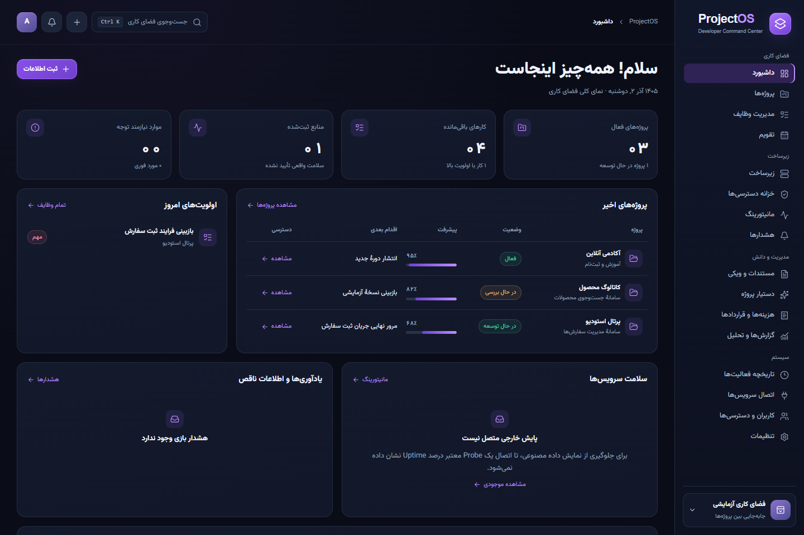
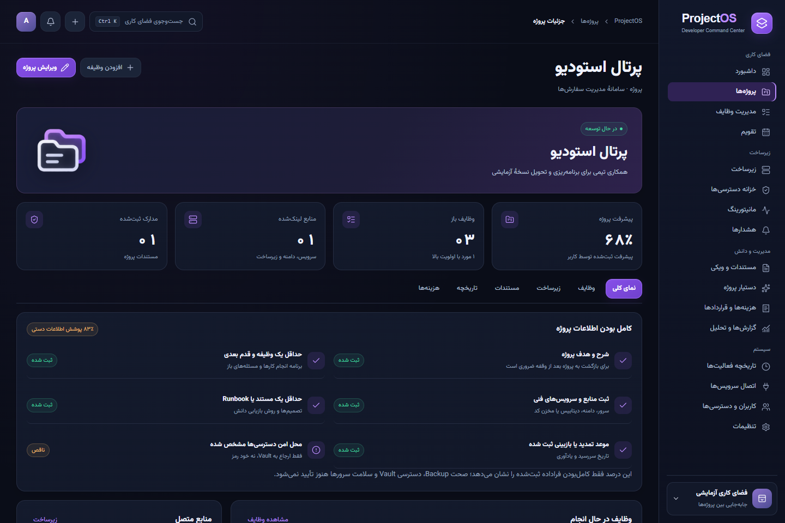
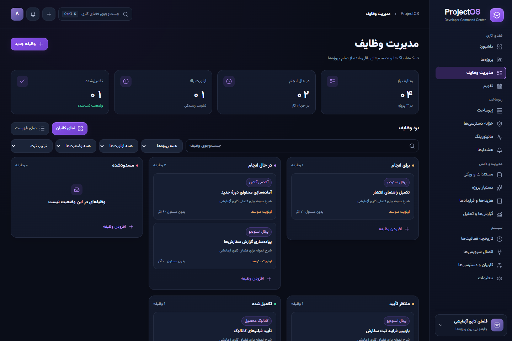
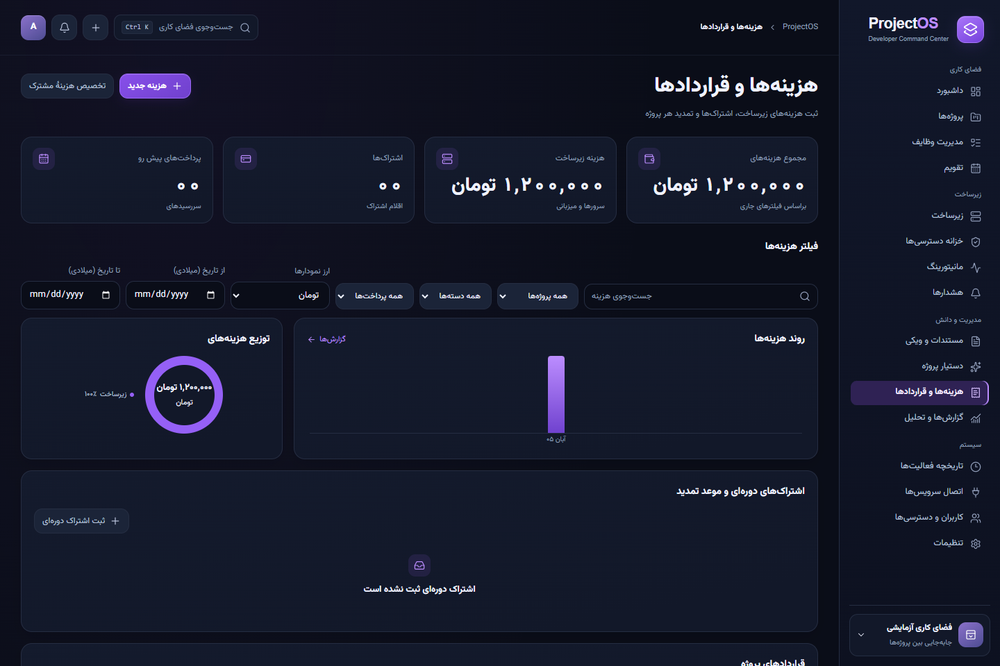
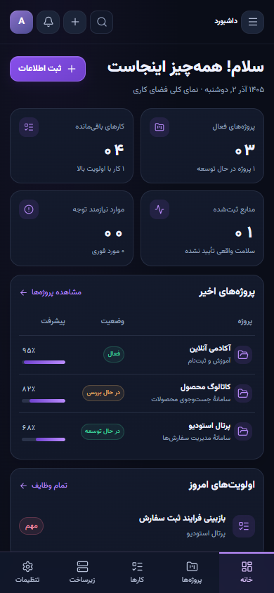

<div dir="rtl" align="right">

# ProjectOS

ProjectOS یک فضای کاری فارسی و راست‌چین برای تیم‌های نرم‌افزاری است. در هر پروژه می‌توانید وضعیت کار، قدم بعدی، منابع زیرساخت، مستندات و هزینه‌ها را کنار هم ببینید.

**وضعیت فعلی: پیش‌نمایش خصوصی.** راه‌اندازی محلی با دادهٔ آزمایشی مسیر پیشنهادی است. کارکرد اتصال‌ها به پیکربندی سرویس‌ها وابسته است و انتشار Production به تأیید جداگانه در محیط هدف نیاز دارد.

[امکانات](#features) · [تصاویر رابط](#screenshots) · [شروع سریع](#quickstart) · [PostgreSQL](#postgresql) · [آزمون‌ها](#testing) · [مستندات و مجوز](#documentation)

<a name="screenshots"></a>

## نمای رابط کاربری

تصویرها از برنامهٔ در حال اجرا، در یک فضای کاری با پروژه‌ها و داده‌های ساختگی گرفته شده‌اند.



<details>
<summary><strong>جزئیات پروژه، برد وظایف و صفحهٔ مالی</strong></summary>

### جزئیات پروژه



### برد وظایف



### هزینه‌ها و قراردادها



</details>

<details>
<summary><strong>داشبورد در موبایل</strong></summary>



</details>

<a name="features"></a>

## امکانات

| بخش | کارهایی که می‌توانید انجام دهید |
| --- | --- |
| پروژه‌ها و وظایف | مدیریت وضعیت و پیشرفت، ثبت قدم بعدی، برد کانبان و نمای فهرست، اولویت، سررسید، چک‌لیست و وابستگی وظایف. |
| زیرساخت و پایش | ثبت سرور، دامنه، دیتابیس و سرویس، مشاهدهٔ داده‌های HTTPS و عامل میزبان همراه با زمان و منبع، پیگیری رخدادهای SLO و شواهد VPN. |
| تقویم و اعلان‌ها | ثبت یادآوری یک‌باره یا تکرارشونده، مشاهدهٔ هشدار در برنامه و پیگیری وضعیت ارسال پس از تنظیم ایمیل یا تلگرام. |
| هزینه‌ها و قراردادها | ثبت هزینه، اشتراک، قرارداد، فاکتور و پرداخت، تخصیص مساوی هزینهٔ مشترک، تطبیق قرارداد با فاکتور و نرخ دستی یا دوره‌ای USD/IRR. |
| مستندات و دانش | ثبت Runbook و تصمیم‌ها، تاریخچهٔ نسخهٔ سند، جست‌وجوی مجوزمحور و بازیابی معنایی محلی با پیوند به منبع. |
| GitHub و Vault | مشاهدهٔ فعالیت مخزن، همگام‌سازی با Webhook و Worker، و بررسی فرادادهٔ ارجاع‌های تأییدشده در HashiCorp Vault KV v2. |
| تیم و دسترسی‌ها | دعوت به فضای کاری، نقش مالک، ویرایشگر و بیننده، تخصیص دسترسی پروژه، مدیریت نشست و MFA مبتنی بر TOTP. |

نشانه‌های پایش بر مبنای مشاهدهٔ ثبت‌شده نمایش داده می‌شوند. دادهٔ قدیمی یا ناموجود وضعیت جداگانه دارد. ثبت دست‌دهی WireGuard و پاسخ سرویس محلی دو نوع شاهد برای بررسی VPN هستند. در بخش خزانه، فراداده و ارجاع ثبت می‌شود و مقادیر محرمانه در Vault می‌مانند.

<a name="quickstart"></a>

## شروع سریع با SQLite

**پیش‌نیازها** · Git، Node.js نسخهٔ ۲۲٫۱۸ یا بالاتر و npm. فرمان زیر شاخهٔ فعلی پیش‌نمایش را دریافت می‌کند. SQLite برای شروع محلی کافی است.

<div dir="ltr">

```sh
git clone --branch production/gate-b-runtime-role https://github.com/alirava56/project_os.git
cd project_os
npm ci --include=optional
```

</div>

در یک کلون تازه، فایل تنظیمات محلی را از نمونه بسازید. اگر `.env.local` از قبل وجود دارد، تنظیمات همان فایل را ویرایش کنید.

- **PowerShell** · `Copy-Item .env.example .env.local`
- **Bash** · `cp .env.example .env.local`

با دستور زیر یک توکن محلی تولید کنید و مقدار آن را در `PROJECTOS_SETUP_TOKEN` داخل `.env.local` قرار دهید. `PROJECTOS_DATABASE_URL` و `PROJECTOS_DATABASE_MODE` را برای این روش خالی بگذارید.

<div dir="ltr">

```sh
node -e "console.log(require('node:crypto').randomBytes(32).toString('hex'))"
npm run dev -- --hostname 127.0.0.1
```

</div>

1. نشانی [راه‌اندازی محلی](http://127.0.0.1:3000/setup) را در مرورگر باز کنید.
2. توکن را برای ساخت مالک اولیه و فضای کاری وارد کنید.
3. توکن را از `.env.local` حذف کنید و سرور توسعه را دوباره اجرا کنید.

مسیر پیش‌فرض دیتابیس `local-data/projectos.sqlite` است. فایل تنظیمات محلی، دیتابیس و مقادیر محرمانه را بیرون از Git نگه دارید.

<a name="postgresql"></a>

## PostgreSQL و سرویس‌های اختیاری

برای آزمایش رفتار نزدیک‌تر به محیط عملیاتی از یک PostgreSQL مستقل با دادهٔ ساختگی استفاده کنید. مهاجرت‌ها با `npm run db:migrate` و اتصال نقش نصب اجرا می‌شوند. حساب وب و Workerها باید جداگانه و با حداقل مجوز تنظیم شوند. برنامهٔ وب با `PROJECTOS_DATABASE_MODE=postgres`، نشانی پایگاه داده و کلید امضای Workspace راه‌اندازی می‌شود. پیش از تغییر موتور ذخیره‌سازی، مراحل تطبیق داده و بازگشت را در راهنمای مهاجرت دنبال کنید. [راهنمای اجرای خصوصی](docs/operations/DEPLOYMENT-FA.md) · [مهاجرت SQLite و Rollback](docs/migrations/SQLITE-TO-POSTGRES-FA.md)

| قابلیت | پیش‌نیاز و فرمان |
| --- | --- |
| همگام‌سازی خودکار GitHub | فهرست مخازن مجاز، Webhook امضاشده، توکن فقط‌خواندنی و نقش Worker. اجرا با `npm run github:worker`. |
| دریافت دوره‌ای نرخ ارز | CurrencyAPI، پروژه‌های مجاز و فاصلهٔ زمانی ثبت‌شده. اجرا با `npm run currency:worker`. |
| پایش و رخدادها | میزبان‌های HTTPS مجاز و تنظیم آستانه‌های SLO. اجرا با `npm run monitors`. عامل گزارش میزبان با `npm run monitor:agent` اجرا می‌شود. |
| یادآوری و اعلان | Workerهای جداگانهٔ `npm run reminders` و `npm run notifications:deliver`. ارسال خارجی با تنظیم سروری ایمیل یا تلگرام فعال می‌شود. |
| ارجاع Vault | نشانی HTTPS، مسیرهای مجاز KV v2 و توکن خواندن فراداده روی سرور. |
| جست‌وجوی معنایی | PostgreSQL، سرویس محلی E5 Base و ساخت نمایه به‌وسیلهٔ مالک پروژه. وزن‌های مدل خارج از مخزن نگهداری می‌شوند. |

تنظیمات، نقش‌های Worker و شیوهٔ اجرای مدل در [راهنمای سرویس‌های Gate D](docs/operations/GATE-D-WORKERS-FA.md) و [راهنمای اتصال‌ها](docs/operations/INTEGRATIONS-FA.md) آمده‌اند.

<a name="testing"></a>

## توسعه و آزمون

<div dir="ltr">

```sh
npm run typecheck
npm run lint
npm run test:core
npm audit --audit-level=high
npm run build
npx playwright install chromium
npm run test:smoke
```

</div>

Smoke روی Build برنامه و دادهٔ موقت اجرا می‌شود. برای آزمون یکپارچه، `PROJECTOS_TEST_POSTGRES_URL` را روی دیتابیس مدیریتی `postgres` در یک سرور آزمایشی loopback تنظیم کنید. ابزارهای PostgreSQL باید با نسخهٔ همان سرور سازگار باشند. آزمون‌ها دیتابیس‌های موقت خودشان را ایجاد و پاک می‌کنند.

<div dir="ltr">

```sh
npm run test:postgres
npm run test:postgres-http
npm run test:project-lifecycle
npm run test:postgres-browser -- --browser=chromium
```

</div>

آزمون‌های مرورگر PostgreSQL به گواهی TLS آزمایشی loopback نیاز دارند. نحوهٔ ساخت گواهی و اجرای Chromium، Firefox و WebKit در [تعریف GitHub Actions](.github/workflows/ci.yml) آمده است.

## معماری مخزن

| مسیر | مسئولیت |
| --- | --- |
| [`src/app`](src/app) | صفحات Next.js و APIهای رکوردمحور |
| [`src/components`](src/components) | اجزای رابط React و نمایش فارسی RTL |
| [`src/lib/server`](src/lib/server) | نشست، کنترل دسترسی، اعتبارسنجی، ذخیره‌سازی و اتصال‌ها |
| [`schema/postgres`](schema/postgres) | مهاجرت‌ها، سیاست‌های مجوز و نقش‌های پایگاه داده |
| [`scripts`](scripts) | Workerها، ابزارهای مهاجرت، عملیات و آزمون |
| [`tests`](tests) | آزمون‌های مرورگر و مسیرهای سرتاسری |

<a name="documentation"></a>

## مستندات و مجوز

- [قرارداد API](docs/architecture/API-CONTRACT.md) و [مدل داده](docs/architecture/ERD.md)
- [ماتریس مجوزها](docs/security/AUTHZ-MATRIX.md) و [مدل تهدید](docs/security/THREAT-MODEL.md)
- [راهنمای پشتیبان‌گیری و بازیابی](docs/operations/BACKUP-RESTORE-FA.md) و [راهنمای عملیات](docs/operations/RUNBOOK-FA.md)

کد ProjectOS تحت [مجوز MIT](LICENSE) منتشر می‌شود. این مجوز استفاده و تغییر و بازتوزیع را با حفظ متن مجوز و اطلاعیهٔ حق نشر مجاز می‌کند. وابستگی‌های شخص ثالث تابع مجوزهای خودشان هستند.

</div>
